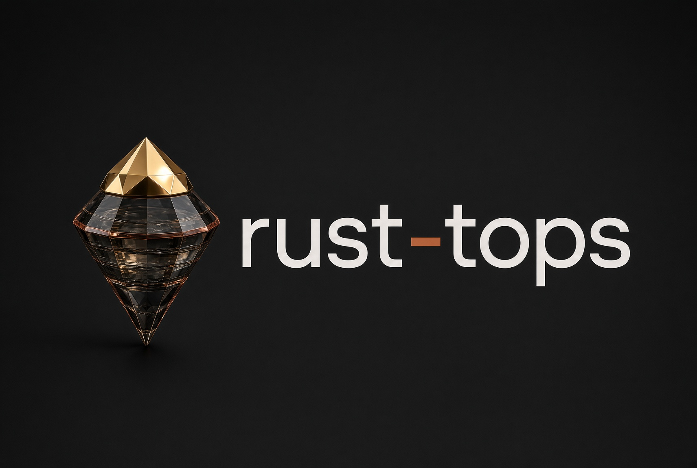

# Rust-TOPS

<p align="center">
  
</p>

<p align="center"><strong>A protocol and drop-in kit for Rust that is correct, dense, and fast.</strong><br/>
Spec, schema, class gates, and a thin orchestrator for the Cargo tools you already run.</p>

<p align="center">
  <a href="https://www.rust-lang.org"></a>
  <a href="https://github.com/Hedronite"></a>
  <a href="RUST_TOPS.md"></a>
  <a href="laws/README.md"></a>
  <br/>
  <a href="https://crates.io/crates/cargo-tops"></a>
  <a href="https://github.com/Hedronite/rust-tops/releases/latest"></a>
  <a href="#pins"></a>
  <a href="LICENSE"></a>
  <a href="https://github.com/Hedronite/rust-tops/actions/workflows/rust-tops.yml"></a>
</p>

<p align="center">
  <a href="#quick-start">Quick start</a> ·
  <a href="#what-you-get">What you get</a> ·
  <a href="#how-it-works">How it works</a> ·
  <a href="#status">Status</a> ·
  <a href="RUST_TOPS.md">Protocol</a> ·
  <a href="POLICIES.md">CI floor</a> ·
  <a href="laws/README.md">Bend2 pack</a> ·
  <a href="AGENTS.md">Harness</a>
</p>

<p align="center">
  Built by <a href="https://github.com/Hedronite">Hedronite</a>.<br/>
  CRAP scores use the 2007 Change Risk Anti-Patterns formula. This kit did not originate that metric.
</p>

---

Rust-TOPS (Rust Testing and Optimization Protocol Suite) is a protocol: a written spec, a JSON Schema, per-crate class floors, and the practice layer in [`POLICIES.md`](POLICIES.md). This repository is the public kit for adopting that protocol.

It is for Rust library and binary authors, and for the people who own their CI, who want one gate order: lint, tests, coverage, CRAP, mutation on the diff, then the extra layers the crate class names.

Protocol 1.1.0 adds the `laws` layer ([`RUST_TOPS.md`](RUST_TOPS.md) §3.1). It checks an adopting crate against the Bend2 laws pack under [`laws/`](laws/). For each law, the runner reads one fact from the crate's files or this gate run's reports and picks a case. `bend` then judges the case file, one program that imports `LAWS.bend`. A `Refuse` fails the gate. Fifteen of the 53 laws have fact readers. The other thirty-eight are reported `not-evaluated`, never as a pass. On this repository, required CI also proves all 53 laws with Bend 2.0.36 (TOFU-pinned) and rechecks them with Lean 4.34.0.

## Pins

| Plane | Pin | Where |
| --- | --- | --- |
| Protocol | 1.1.0 | [`RUST_TOPS.md`](RUST_TOPS.md), [`schema/rust-tops.schema.json`](schema/rust-tops.schema.json) |
| Package | 0.2.0 | workspace [`Cargo.toml`](Cargo.toml). Tagged `v0.2.0` at commit `e0fa684`. [GitHub release v0.2.0](https://github.com/Hedronite/rust-tops/releases/tag/v0.2.0). [crates.io](https://crates.io/crates/cargo-tops) `cargo-tops` 0.2.0 (2026-10-22 00:44 ET) |
| This package | edition 2021, MSRV 1.99.1 | [`Cargo.toml`](Cargo.toml); the `msrv` job uses Rust 1.99.1. Compiling this package needs Rust 1.99.1, and Cargo stops on an older compiler before the build. |
| Crate page | 0.2.0 | [docs.rs/cargo-tops](https://docs.rs/cargo-tops) |
| Tool lock | rustc 1.91.0, cargo-nextest 0.9.145, cargo-crap 0.5.0, cargo-deny 0.18 | [`rust-tops.lock`](rust-tops.lock) |
| Bend | 2.0.36 TOFU | [`laws/bend.lock`](laws/bend.lock). The upstream release is mutable and unsigned (no checksum file, no signatures, no attestations). |
| Lean | 4.34.0 TOFU | [`laws/bend.lock`](laws/bend.lock) archive `lean-4.34.0-linux.tar.zst`, used by `bend PROOF.bend --verdict`. |

The tool lock is the version set used to evaluate gates. It is a different number from the MSRV. [`config/rust-tops.lock.example`](config/rust-tops.lock.example) is the same pin list, for copying into an adopting crate.

## Quick start

### Copy the files

```bash
cp config/rust-tops.example.yaml   ./rust-tops.yaml
cp config/rust-tops.lock.example   ./rust-tops.lock
cp AGENTS.md                       ./AGENTS.md
cp config/drop-in/clippy.toml      ./clippy.toml
cp config/drop-in/nextest.toml     ./.config/nextest.toml
cp config/drop-in/mutants.toml     ./.cargo/mutants.toml
cp config/drop-in/cargo-crap.toml  ./.cargo-crap.toml
cp config/drop-in/deny.toml        ./deny.toml
cp config/drop-in/rust-tops.yml    ./.github/workflows/rust-tops.yml
```

The example instance is a `parser-codec` sketch: edition 2024, MSRV 1.88. Replace `crate.class`, `crate.edition`, `crate.msrv`, coverage floors, `exemptions`, and `hot_paths`. The sample hot paths are not a file list of [`examples/parser-codec`](examples/parser-codec) (that fixture has `src/varint.rs` and no `src/frame.rs`).

In the workflow, replace `{MSRV}`, `{PRIMARY_PKG}`, `{SYSDEPS}`, and `{FFI_FEATURE}`. The copied workflow is a floor. See [`POLICIES.md`](POLICIES.md).

### Or install the orchestrator

```bash
cargo install cargo-tops
cargo tops init --class parser-codec
cargo tops check
cargo tops gate
```

`--class` accepts `library-core` (the default), `parser-codec`, `no-std-embedded`, `unsafe-kernel`, or `binary-cli`. `init` writes `rust-tops.yaml` (protocol 1.1.0, `laws` layer enabled at tier 0), `rust-toolchain.toml` (`channel` = `crate.msrv`), `AGENTS.md`, the drop-in configs, a class workflow at `.github/workflows/rust-tops.yml`, `LAWS.bend`, `laws/bend.lock`, and `scripts/fetch-bend.sh`. It does not write `rust-tops.lock`. The generated instance still starts from the parser-codec example (edition 2024, MSRV 1.88).

`check` reads `rust-tops.yaml` and checks protocol id, a non-empty version, a crate name, `gates.crap.threshold_agent >= 1`, and that class `library-core` keeps `unexplained_survivors_max` at 0.

`gate` runs enabled layers at or below `--max-tier` (default 1). `--dry-run` prints the commands and does not run them. A mapped tool missing from `PATH` fails the gate. The `laws` layer runs last, on the reports the other layers wrote. When Bend 2.0.36 is absent, `gate` fetches it by `laws/bend.lock` first.

### Nix

```nix
{
  inputs.rust-tops.url = "github:Hedronite/rust-tops";
  outputs = { nixpkgs, rust-tops, ... }:
    let
      pkgs = import nixpkgs {
        system = "aarch64-darwin";
        overlays = [ rust-tops.overlays.default ];
      };
    in {
      packages.aarch64-darwin.default = pkgs.cargo-tops;
      # pkgs.rust-tops-laws -> $out/share/rust-tops/laws
    };
}
```

`overlays.default` exposes `cargo-tops` and `rust-tops-laws`. Flake systems are `aarch64-darwin`, `x86_64-darwin`, `aarch64-linux`, and `x86_64-linux`. Intel macOS follows input `nixpkgs-darwin-x64` (`nixpkgs-26.05-darwin`). The other systems follow `nixos-unstable`. `devShells.default` includes `cargo-tops`, `rustc`, `cargo`, `clippy`, and `rustfmt`.

```bash
nix flake check
./scripts/bend-gate.sh
```

`nix flake check` builds both packages, runs `law-catalog-names`, and on Linux runs `bend-proof` (the real Bend proof, fetched by the lock sha256). Darwin has no `bend-proof` attribute: the Bun binary was not verified in the Nix darwin sandbox, and that name is never a names-only pass. No GitHub Actions job runs `nix flake check`, so Nix is local feedback, not a gate. `bend-gate.sh` checks names, template bytes, and the Bend version, then runs `bend PROOF.bend`. A missing `bend` exits 1. `BEND_GATE_NAMES_ONLY=1` is the local names-only opt-in and prints `NAMES-ONLY (not a proof)`.

## What you get

| | Cargo alone | This kit |
| --- | --- | --- |
| Contract | Docs and tests you arrange | Protocol 1.1.0 and a draft 2020-12 JSON Schema |
| Class floors | None | Five profile files; the schema allows eleven class names |
| Drop-in configs | None | clippy, nextest, mutants, cargo-crap, cargo-deny, GitHub Actions floor |
| Orchestrator | You sequence the commands | `cargo tops init`, `check`, and `gate` |
| CI on this repo | — | `fmt-clippy-deny`, `nextest`, `msrv`, `feature-matrix`, `coverage-crap`, `bend-proof`, `bend-verdict`, `bend-gate-matrix`, plus `law-diff`. `bend-proof-macos` is informational |
| CRAP config | — | [`.cargo-crap.toml`](.cargo-crap.toml): threshold `6.0`; excludes `src/generated/**`, `tests/**`, `benches/**`, `examples/**` |
| Bend2 | — | 53 laws, H-01 through H-53. The `laws` layer has `bend` judge fifteen against your crate; thirty-eight are `not-evaluated`. Required CI on this repo proves all 53 |
| Nix | — | Overlay and packages `cargo-tops`, `rust-tops-laws` |

### What you do not get

| Claim | Reality |
| --- | --- |
| A test engine | `cargo-tops` shells out to `cargo fmt`, Clippy, nextest, `cargo llvm-cov`, `cargo-crap`, `cargo-mutants`, and `cargo-deny`. |
| JSON Schema validation from `cargo tops check` | That command is the typed check in the quick start. Point a draft 2020-12 validator at [`schema/rust-tops.schema.json`](schema/rust-tops.schema.json) to check an instance. |
| Fuzz, Miri, Kani, loom, sanitizers, or Callgrind from `cargo tops gate` | Those layer ids have no command mapping. The gate prints `skip` and continues. |
| Mutants, Darwin, or fuzz jobs in this repo | They are comments in [`.github/workflows/rust-tops.yml`](.github/workflows/rust-tops.yml). The feature matrix checks `cargo-tops` and `parser-codec` with `--no-default-features`, and `no-std-embedded` both with `--no-default-features` and with `--features std`. |
| Every law judged on your crate | Fifteen laws have fact readers. Thirty-eight, including `evidence_not_self_served`, are reported `not-evaluated` and never count as a pass ([`RUST_TOPS.md`](RUST_TOPS.md) §3.1). The schema names the `laws` layer; the laws live in `LAWS.bend`. Hard rows encode as `Refuse`; soft rows as `Ack`. Catalog: [`BEND2-INTEGRATION.md`](BEND2-INTEGRATION.md). |
| A green gate when `bend` is absent | Missing `bend` exits 1 (`H-37`). Names-only is the explicit opt-in `BEND_GATE_NAMES_ONLY=1`, and CI refuses that variable. |
| `cargo tops init` for every schema class | The CLI classes are the five named above. The schema also lists `library-util`, `binary-service`, `concurrency-runtime`, `ffi-bridge`, `proc-macro`, and `workspace-root`. Those six have no profile file and no `--class` value. |
| Published example crates | [`examples/parser-codec`](examples/parser-codec) and [`examples/no-std-embedded`](examples/no-std-embedded) set `publish = false`. |
| A written gate report | [`schema/gate-report.schema.json`](schema/gate-report.schema.json) describes an optional report object. The CLI prints text and does not write that object. |

## How it works

Write the oracle from the contract, then the smallest production code that meets it. A test taken from the function body freezes current behavior, including bugs. Splitting a function only to lower its CRAP score violates the spec's scar-guard.

Order for a gated change, from [`RUST_TOPS.md`](RUST_TOPS.md):

1. `cargo fmt`, Clippy with `-D warnings`, `cargo deny check`.
2. `cargo nextest` (profile `ci`) and `cargo test --doc`.
3. `cargo llvm-cov` writing LCOV, then `test -s` on that file.
4. `cargo crap --lcov` against that LCOV. The drop-in threshold is 6.0. Pass `--lcov` on the CLI. `fail = true` is not a cargo-crap config field.
5. `cargo mutants --in-diff`. The gate diffs `origin/main...HEAD`.
6. Property tests, fuzz, Miri, Kani, and Callgrind when the crate class requires them. `cargo tops gate` has no commands for this step.

The protocol cap for new human-authored code is CRAP 4. The cap for new code written by a coding agent is CRAP 6. A class table can set other numbers: [`profiles/binary-cli.yaml`](profiles/binary-cli.yaml) uses human 6 and agent 8. Coverage floors live in `rust-tops.yaml`. The drop-in workflow does not pass `--fail-under-lines`.

| Path | Role |
| --- | --- |
| [`RUST_TOPS.md`](RUST_TOPS.md) | Normative protocol 1.1.0 |
| [`schema/`](schema/) | Draft 2020-12 schema for an instance, and a separate optional gate-report schema |
| [`POLICIES.md`](POLICIES.md) | CI floor and the checks harvested from applying the protocol |
| [`config/rust-tops.example.yaml`](config/rust-tops.example.yaml) | Example `parser-codec` instance |
| [`config/drop-in/`](config/drop-in/) | Files to copy into an adopting crate |
| [`profiles/`](profiles/) | `library-core`, `parser-codec`, `binary-cli`, `no-std-embedded`, `unsafe-kernel` |
| [`crates/cargo-tops`](crates/cargo-tops) | The `cargo-tops` binary. Published templates live in `crates/cargo-tops/templates/` |
| [`examples/`](examples/) | Fixtures: a small frame and varint codec, and a `no_std` ring buffer |
| [`AGENTS.md`](AGENTS.md) | Harness for coding agents editing a crate under the protocol |
| [`BEND2-INTEGRATION.md`](BEND2-INTEGRATION.md) | Candidate laws and their sources. The `laws` layer is spec §3.1 |
| [`laws/`](laws/) | `LAWS.bend`, `PROOF.bend`, `NAMES` (H-01..H-53) |
| [`flake.nix`](flake.nix) | Nix overlay |
| [`CHANGELOG.md`](CHANGELOG.md) | Package history. Protocol 1.1.0 and package 0.2.0 are separate version planes |

## Status

This tree is package **0.2.0** and protocol **1.1.0**. The release notes are [`CHANGELOG.md`](CHANGELOG.md) `[0.2.0]`. Tagged `v0.2.0` at commit `e0fa684`. [GitHub release v0.2.0](https://github.com/Hedronite/rust-tops/releases/tag/v0.2.0). [crates.io](https://crates.io/crates/cargo-tops) `cargo-tops` 0.2.0 published 2026-10-22 00:44 ET.

This repository's workflow runs format and Clippy, `cargo deny`, nextest, doc tests, an MSRV check on 1.99.1, the feature matrix above, and a coverage job that fails when `lcov.info` or the CRAP JSON is empty. It also runs `bend-proof`, `bend-verdict`, and `bend-gate-matrix`. `law-diff` is a separate workflow. The workspace lint `unsafe_code = "forbid"` applies to `cargo-tops` and both fixtures.

The Bend2 pack is 53 laws. [`scripts/bend-gate.sh`](scripts/bend-gate.sh) checks names and template bytes, requires `bend` 2.0.36 from [`laws/bend.lock`](laws/bend.lock), and uses the exit code of `bend PROOF.bend` as the verdict. On an adopting crate, the `laws` layer judges fifteen of them with `bend`, and thirty-eight are `not-evaluated` ([`RUST_TOPS.md`](RUST_TOPS.md) §3.1). Moving a law into [`RUST_TOPS.md`](RUST_TOPS.md) takes an explicit spec bump. Public [`RUST_TOPS.md`](RUST_TOPS.md) still stops at §24. The review gate in [`docs/REVIEW.md`](docs/REVIEW.md) is additive guidance, not a protocol section.

`cargo tops init --skills` writes a portable skill layout. The canonical copy is `.agents/skills/<name>/`. Codex and omp read that path. Cursor's native directory is `.cursor/skills/<name>/`; its docs also list `.agents/skills/` and `.claude/skills/`. `.claude/skills/<name>/`, `.cursor/skills/<name>/`, and `.grok/skills/<name>/` are ordinary-file copies of the same bytes. The layout uses regular files. `cargo test --workspace` fails if any copy differs or is a symlink. `CLAUDE.md` is one line, `@AGENTS.md`, so Claude Code imports the harness. `AGENTS.md` stays the instruction file. Default `cargo tops init` does not write those files.

Current limits:

- `cargo tops gate` runs the mapped commands through tier 1.
- `cargo tops init` covers five classes. The other six names exist in the schema and the spec table.
- `bend-gate.sh` exits 1 when `bend` is absent.
- The `laws` layer has fact readers for fifteen of the 53 laws. The rest are `not-evaluated`.
- `bend-proof-macos` is informational. A large Bend pack can overflow the macOS stack; this job does not change `ulimit`.
- Flake support for `x86_64-darwin` tracks `nixpkgs-26.05-darwin`, because the `nixos-unstable` pin dropped Intel macOS. Darwin `checks.bend-proof` is absent.

## Contributing

Read [`RUST_TOPS.md`](RUST_TOPS.md) and [`schema/rust-tops.schema.json`](schema/rust-tops.schema.json) before changing a gate. When prose and schema disagree, fix the schema, then the prose.

[`POLICIES.md`](POLICIES.md) is the CI floor. [`AGENTS.md`](AGENTS.md) is the editing harness. Bend2 work starts at [`laws/README.md`](laws/README.md) and [`BEND2-INTEGRATION.md`](BEND2-INTEGRATION.md). Leave a law as written; do not weaken it so a proof passes.

Package history is [`CHANGELOG.md`](CHANGELOG.md).

## Credits and license

Built by Hedronite. Licensed under MIT OR Apache-2.0, at your option. See [`LICENSE`](LICENSE), [`LICENSE-MIT`](LICENSE-MIT), and [`LICENSE-APACHE`](LICENSE-APACHE).

The CRAP formula is Change Risk Anti-Patterns (2007), cited in [`RUST_TOPS.md`](RUST_TOPS.md). Names such as `cargo-llvm-cov`, `cargo-mutants`, `cargo-crap`, nextest, and `cargo-deny` refer to those tools.
